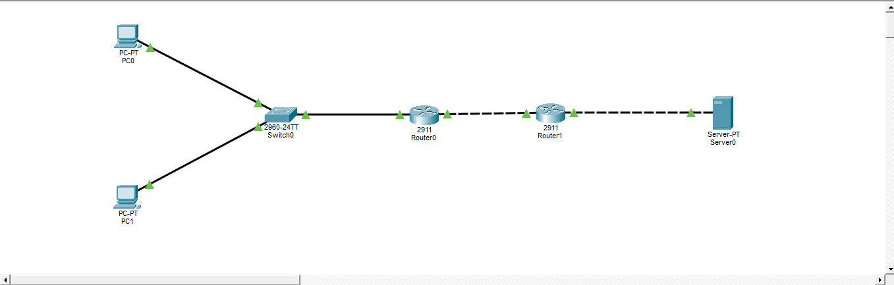
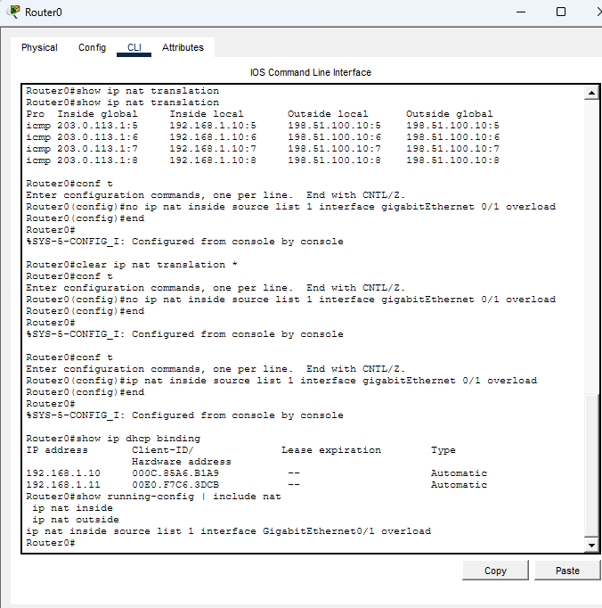
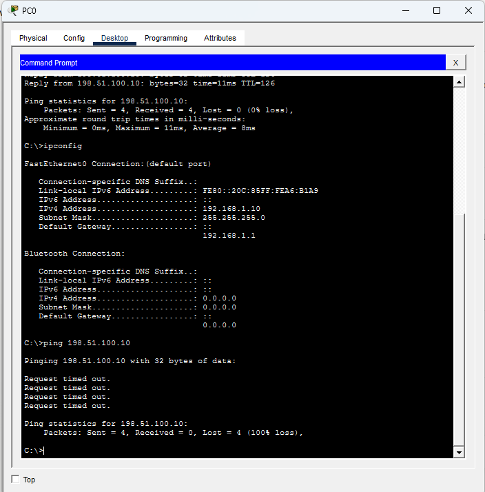
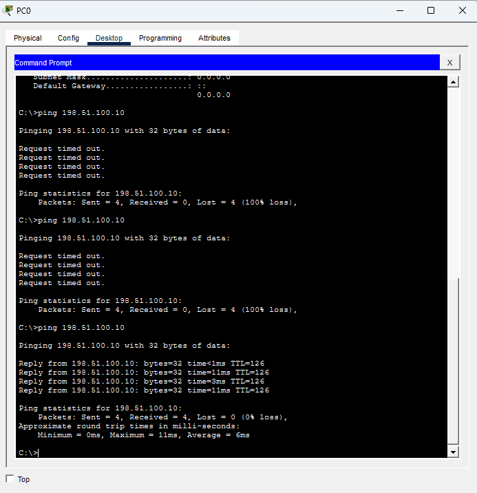
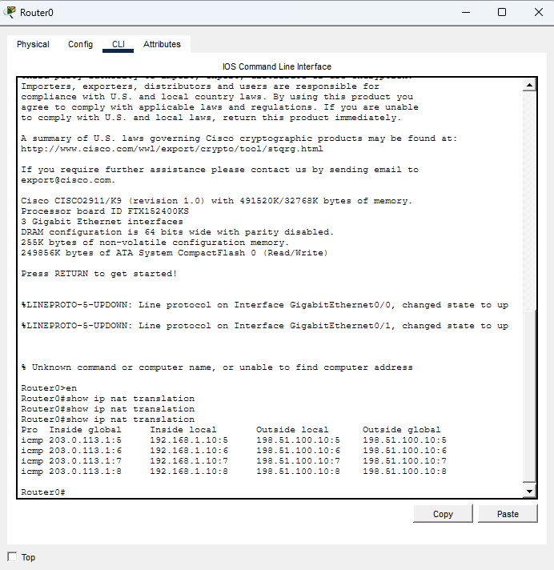

# Lab 2: DHCP and NAT (PAT)

Tool: Cisco Packet Tracer

## Objective
Configure Router0 as a DHCP server for the office LAN and enable PAT
(NAT overload) so internal PCs can reach an external server through an ISP router.

## Topology

## IP Addressing
| Link | Network | Addresses |
|------|---------|-----------|
| Office LAN | 192.168.1.0/24 | Router0 Gi0/0 = 192.168.1.1, PCs via DHCP |
| Router0 to Router1 | 203.0.113.0/30 | Router0 Gi0/1 = .1, Router1 Gi0/0 = .2 |
| Router1 to Server | 198.51.100.0/24 | Router1 Gi0/1 = .1, Server = .10 |

## Key Configuration (Router0)
- DHCP pool OFFICE_LAN for 192.168.1.0/24, addresses .1 to .9 excluded
- Default route to 203.0.113.2
- Gi0/0 as NAT inside, Gi0/1 as NAT outside
- PAT using access-list 1 and the Gi0/1 interface address (overload)

## Verification

### DHCP bindings and NAT configuration

### Before NAT
PC0 gets 192.168.1.10 from DHCP, but ping to the server (198.51.100.10) fails.
The ISP router has no route back to the private network.

### After NAT
The same ping succeeds (TTL=126, routed through two routers).

### NAT translations
PC0 (192.168.1.10) is translated to 203.0.113.1.

