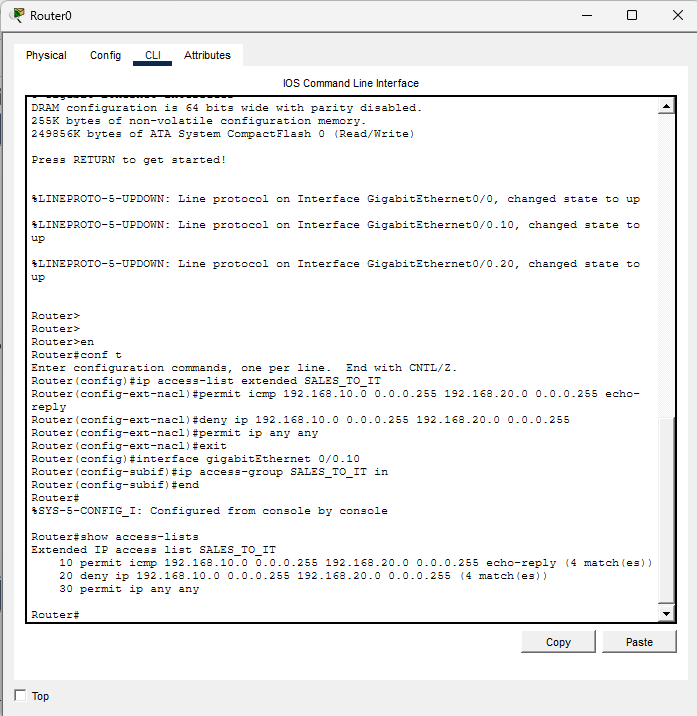
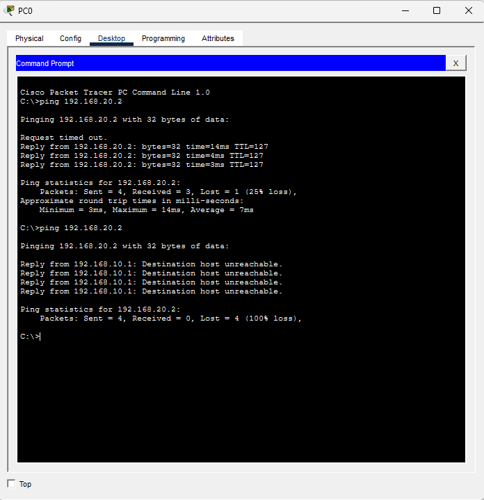
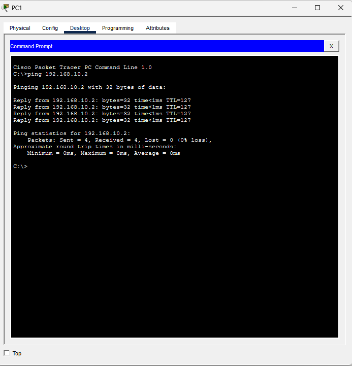

# Lab 3: Access Control List (ACL)

Tool: Cisco Packet Tracer

## Objective
Restrict the Sales VLAN (VLAN 10) from reaching the IT VLAN (VLAN 20)
while allowing IT to reach Sales, using an extended ACL on the router.

## Topology
Same as Lab 1 (VLAN 10 Sales, VLAN 20 IT, router-on-a-stick).

## ACL Configuration (Router0)
- Extended ACL SALES_TO_IT applied inbound on Gi0/0.10 (Sales subinterface)
- Permit ICMP echo-reply from Sales to IT (so IT can ping Sales and get replies)
- Deny all other traffic from Sales to IT
- Permit everything else (otherwise the implicit deny blocks all traffic)

## Verification

### ACL rules and match counters

### Sales to IT: before and after ACL
Before the ACL the ping succeeds. After the ACL it fails with
"Destination host unreachable" returned by the router (192.168.10.1).

### IT to Sales: allowed
IT can still ping Sales because the return traffic is permitted.

